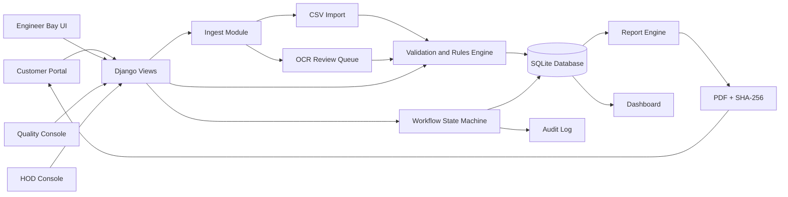

# ATRG Architecture

## High-Level Architecture

ATRG is built as a single Django web application with modular Django apps.

This keeps the prototype:

- offline-friendly
- easy to demo on one laptop
- easy for CPRI engineers to maintain
- ready for future microservice separation

---

## Module Map

| Module | Django App | Responsibility |
|---|---|---|
| Core schema and types | `core` | Customer, Job, Sample, Test, Measurement, LimitRule, Result, Report, AuditLog |
| Ingest | `ingest` | CSV import, OCR upload, OCR proposal parsing, human confirmation |
| Testing | `testing` | Measurement save service, validation, rules engine, BT/AT anomaly flags |
| Review | `review` | Workflow state machine, role guards, approvals, lock logic |
| Reports | `reports` | HTML template binding, PDF generation, SHA-256 hash, integrity check |
| Portal | `portal` | Internal dashboard, engineer views, customer portal, notifications |

---

## Data Flow



---

## Key Entities

### Job

One job corresponds to one test series.

Example:

```text
CPRIBLRSCL25T1654
```

### Sample

One equipment item under test.

Example:

```text
HVD25S0847
250 kVA, 11000/433 V, Dyn11
```

### Test

One test type performed for a job.

Examples:

```text
Routine Test
Loss Measurement
Short Circuit Test
Temperature Rise Test
Oil/Pressure Test
```

### Measurement

One atomic reading.

Fields:

```text
test
parameter
stage BT/AT
tap_position
phase R/Y/B
value
unit
source MANUAL/IMPORT/OCR
raw_text
confidence
captured_by
captured_at
```

### LimitRule

Standard clause limit.

Example:

```text
IS 1180 EEL-1 total loss at 100% <= 2930 W
```

### Result

Snapshot of rule evaluation.

Fields:

```text
measured
limit
verdict PASS/FAIL/NA
standard clause
evaluated_at
```

---

## Security and Governance

### RBAC

Roles are implemented using Django groups:

```text
Customer
Engineer
Quality
HOD
Admin
```

### Audit Trail

Every important write creates an `AuditLog` row:

```text
who
when
entity
entity_id
action
field
old_value
new_value
```

### Locking

After HOD signature:

```text
Job becomes LOCKED
Measurements cannot be edited
Report cannot be regenerated
Only release is allowed
```

### Integrity

Report generation computes:

```text
SHA-256(report file)
```

The portal can re-hash and verify the stored report.

---

## AI Touches

The system keeps the core deterministic but adds three practical AI-assisted features:

### 1. OCR-assisted ingestion

Scanned logsheets are parsed into proposed measurement rows.

Engineer confirms each row.

### 2. Auto-verdicts

Rules engine evaluates PASS/FAIL with clause citation.

### 3. BT/AT anomaly detection

Large drift between Before Test and After Test values is flagged for Quality review.
```

---

# 9. Create demo script

Create:

